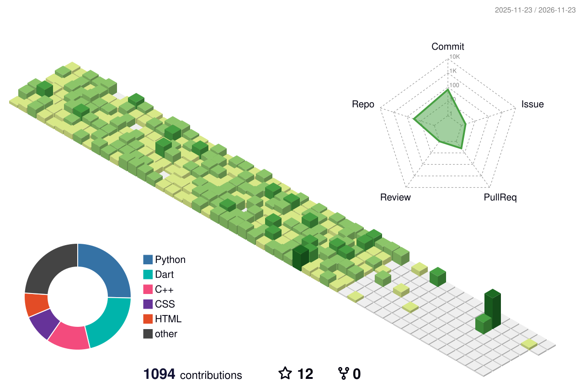

<picture><source media="(prefers-color-scheme: dark)" srcset="assets/dark/typing.svg"/></picture>

<h1 align="center">Mohammed Harun</h1>

  
  
  
  
  
  
  
  
  

<picture><source media="(prefers-color-scheme: dark)" srcset="assets/dark/s01.svg"/></picture>
<picture><source media="(prefers-color-scheme: dark)" srcset="assets/dark/whoami.svg"/></picture>

<picture><source media="(prefers-color-scheme: dark)" srcset="assets/dark/s02.svg"/></picture>
<picture><source media="(prefers-color-scheme: dark)" srcset="assets/dark/ecosystem.svg"/></picture>

<picture><source media="(prefers-color-scheme: dark)" srcset="assets/dark/s03.svg"/></picture>
<picture><source media="(prefers-color-scheme: dark)" srcset="assets/dark/projects.svg"/></picture>

<picture><source media="(prefers-color-scheme: dark)" srcset="assets/dark/certifications.svg"/></picture>

<picture><source media="(prefers-color-scheme: dark)" srcset="assets/dark/s04.svg"/></picture>

<!-- LIVE stats — fetched directly from GitHub API, never cached -->
<picture><source media="(prefers-color-scheme: dark)" srcset="https://github-readme-stats.vercel.app/api?username=SAKMOTO&show_icons=true&hide_border=true&bg_color=0d1117&title_color=ffffff&text_color=ffffff&icon_color=ffffff&count_private=true&include_all_commits=true&line_height=28"/></picture>
<picture><source media="(prefers-color-scheme: dark)" srcset="https://github-readme-streak-stats.herokuapp.com?user=SAKMOTO&theme=dark&hide_border=true&background=0d1117&stroke=ffffff&ring=ffffff&fire=ffffff&currStreakLabel=ffffff&sideLabels=ffffff&sideNums=ffffff&dates=ffffff"/></picture>

<picture><source media="(prefers-color-scheme: dark)" srcset="https://github-readme-stats.vercel.app/api/top-langs/?username=SAKMOTO&layout=compact&hide_border=true&bg_color=0d1117&title_color=ffffff&text_color=ffffff&count_private=true"/></picture>

<picture><source media="(prefers-color-scheme: dark)" srcset="https://github-readme-activity-graph.vercel.app/graph?username=SAKMOTO&bg_color=00000000&color=ffffff&line=ffffff&point=ffffff&area_color=ffffff&area=true&hide_border=true&radius=0&custom_title=CONTRIBUTION%20TELEMETRY"/></picture>

<!-- ═══════════════════════════════════════════════════════ -->
<!--  🌐 3D ISOMETRIC CONTRIBUTION GRAPH (profile-3d-contrib) -->
<!-- ═══════════════════════════════════════════════════════ -->

<picture><source media="(prefers-color-scheme: dark)" srcset="assets/dark/s04b.svg"/></picture>

<picture><source media="(prefers-color-scheme: dark)" srcset="https://raw.githubusercontent.com/SAKMOTO/SAKMOTO/main/profile-3d-contrib/profile-night-rainbow.svg"/></picture>

<picture><source media="(prefers-color-scheme: dark)" srcset="assets/dark/s05.svg"/></picture>
<picture><source media="(prefers-color-scheme: dark)" srcset="assets/dark/timeline.svg"/></picture>
<picture><source media="(prefers-color-scheme: dark)" srcset="assets/dark/experience.svg"/></picture>

<picture><source media="(prefers-color-scheme: dark)" srcset="assets/dark/s06.svg"/></picture>
<picture><source media="(prefers-color-scheme: dark)" srcset="assets/dark/stack.svg"/></picture>

<picture><source media="(prefers-color-scheme: dark)" srcset="assets/dark/s07.svg"/></picture>
<picture><source media="(prefers-color-scheme: dark)" srcset="assets/dark/ai-tools.svg"/></picture>

<picture><source media="(prefers-color-scheme: dark)" srcset="assets/dark/s08.svg"/></picture>
<picture><source media="(prefers-color-scheme: dark)" srcset="assets/dark/dev-tools.svg"/></picture>

<picture><source media="(prefers-color-scheme: dark)" srcset="assets/dark/s09.svg"/></picture>
<picture><source media="(prefers-color-scheme: dark)" srcset="assets/dark/contact.svg"/></picture>

<picture><source media="(prefers-color-scheme: dark)" srcset="assets/dark/s10.svg"/></picture>
<picture><source media="(prefers-color-scheme: dark)" srcset="assets/dark/support.svg"/></picture>

<picture><source media="(prefers-color-scheme: dark)" srcset="assets/dark/s11.svg"/></picture>
<picture><source media="(prefers-color-scheme: dark)" srcset="assets/dark/extras.svg"/></picture>

<picture><source media="(prefers-color-scheme: dark)" srcset="assets/dark/footer.svg"/></picture>

<!-- one responsive picture per visual; no duplicate light/dark rendering -->
